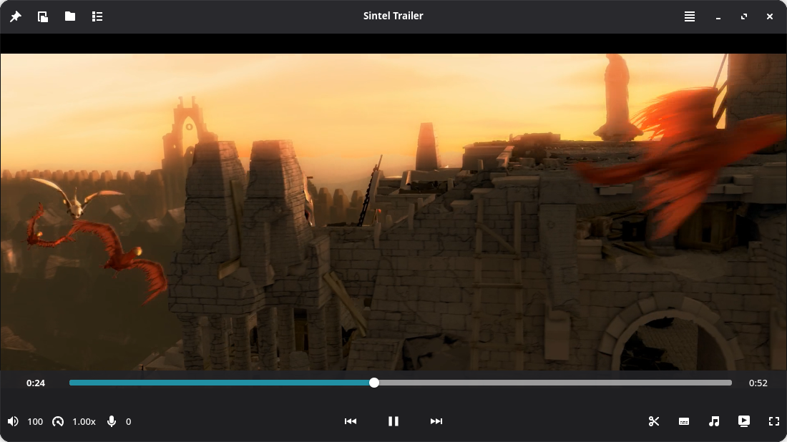
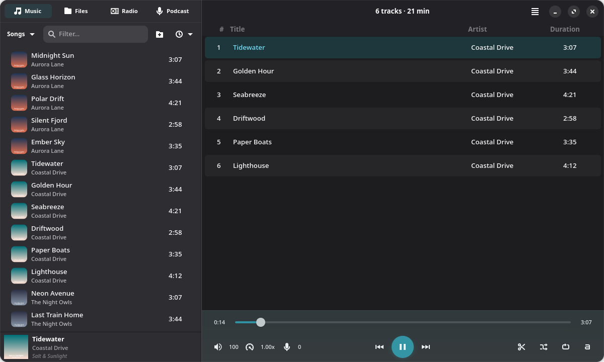

<div align="center">


&nbsp;&nbsp;&nbsp;


# Big Multimedia

**The BigLinux media players: a video player and a music player, built in Rust with GTK 4, libadwaita and mpv.**

[](https://github.com/biglinux/big-multimedia/actions/workflows/build-package.yml)
[](LICENSE)
[](rust-toolchain.toml)
[](https://gtk.org)
[](https://gnome.pages.gitlab.gnome.org/libadwaita/)
[](https://mpv.io)
[](https://www.biglinux.com.br)

[Video Player](#big-video-player) ·
[Audio Player](#big-audio-player) ·
[Install](#installation) ·
[Build](#building-from-source) ·
[Architecture](#architecture) ·
[Contributing](#contributing)

</div>

---

## Overview

Big Multimedia is the workspace behind the two media players of
[BigLinux](https://www.biglinux.com.br). Both share one playback engine
(`big-media-runtime`: mpv playback, casting, media probing) and one set of
interface components, so they look, sound and behave alike.

| Application | Desktop ID | What it is for |
|-------------|------------|----------------|
| **Big Video Player** | `br.com.biglinux.VideoPlayer` | Movies, series, streams and TV channels, with hardware decoding |
| **Big Audio Player** | `br.com.biglinux.AudioPlayer` | A music library, playlists, internet radio and podcasts |

## Big Video Player

<p align="center">
  
</p>

A hardware-accelerated video player that keeps the picture edge to edge and
the controls out of the way.

- **Hardware decoding** through VAAPI, VDPAU and NVDEC, on a GL render path
  with a software fallback.
- **Every common format**: MP4, MKV, WebM, MOV, AVI and anything else mpv
  plays, plus DVD and Blu-ray discs, ISO images and folders.
- **Subtitles** with a secondary track, delay control, styling, and loading of
  external files.
- **Picture and sound**: brightness, contrast and colour, zoom, crop and
  rotation, HDR tone mapping, an equalizer, and upscaling shaders (FSR, CAS,
  RAVU and Anime4K).
- **Streams and TV**: online video, IPTV playlists and Xtream providers, and
  playback on a TV on the same network.
- **Library at hand**: a folder browser and a play queue in a side panel,
  thumbnail previews on the seek bar, and chapters.
- **Cut and convert**: mark the parts to keep and hand them to Big Video
  Converter, or extract the audio track.
- **Desktop integration**: MPRIS for media keys and the desktop's player
  controls, a sleep timer, screenshots, and configurable keyboard shortcuts.

## Big Audio Player

<p align="center">
  
</p>

A music player built around a fast, searchable library.

- **Library** of the music folders you choose, scanned in the background and
  searchable as you type, grouped by song, album, artist or genre.
- **Formats**: MP3, FLAC, OGG Vorbis, Opus, AAC, WAV and more.
- **Playlists and queue**, with undo, import of M3U/PLS playlists and smart
  playlists.
- **Internet radio** with recording, and **podcasts** with subscriptions.
- **Lyrics**, a tag editor and album art.
- **Listening**: gapless playback, crossfade, ReplayGain, an equalizer, speed
  and pitch control, and a sleep timer.
- **Desktop integration**: MPRIS for media keys and the desktop's player
  controls, playback on a TV, and ListenBrainz scrobbling.

Neither player converts media on its own. Cut, Convert and Extract Audio open
`big-video-converter-gui` or `big-audio-converter-gui` with the file and any
marked cuts (`--segments=START-END,...`), through
`big_media_runtime::shared::converter_handoff`.

## Installation

On BigLinux the players come from the official repositories:

```sh
sudo pacman -S big-video-player big-audio-player
```

Packages are built from [`pkgbuild/PKGBUILD`](pkgbuild/PKGBUILD), a single
split recipe that produces both players. A push to a `testing-*` or `stable-*`
branch sends the build request to the BigLinux package builder.

## Building from source

### Requirements

| Dependency | Version |
|------------|---------|
| Rust toolchain | 1.98.1, pinned in [`rust-toolchain.toml`](rust-toolchain.toml) |
| GTK | 4.22 or newer |
| libadwaita | 1.9 or newer |
| libmpv | development files |
| SQLite | development files |
| gettext, pkgconf | for translations and native libraries |

### Build and run

```sh
cargo build --workspace --locked
cargo run --locked -p big-video-player
cargo run --locked -p big-audio-player
```

Either player accepts files on the command line:

```sh
cargo run --locked -p big-video-player -- ~/Videos/movie.mkv
```

### Checks

```sh
cargo clippy --workspace --all-targets --all-features -- -D warnings
cargo test --workspace --locked --all-features
scripts/check-media-surface-imports.sh
```

Tests that create widgets need a Wayland display. Run them in an isolated,
headless compositor so that no window reaches your desktop; see
[`CONTRIBUTING.md`](CONTRIBUTING.md).

## Architecture

```text
crates/
├── big-video-player/        Video player (binary)
├── big-audio-player/        Audio player (binary)
├── media-runtime/           big-media-runtime: mpv engine, casting, probing, settings, translations
├── foundation/              big-os-kit, big-audio-effects, big-media-engines, big-mpv-render, big-media-data
├── app/                     big-app-kit, big-app-kit-core: actions, MPRIS, dialogs, shortcuts
└── ui/
    ├── generic/big-relm4-components     Reusable Relm4/libadwaita components
    └── media/big-media-components       Media chrome, transport, metadata dialogs
        media/big-player-ui              Panels shared by the players
third_party/relm4/           Relm4 with a lifetime patch
```

- Each player keeps its own `resources/` (desktop file, AppStream metadata,
  icon), `application-assets/` (GResource CSS) and `build.rs`.
- The only external BigLinux dependency is
  [big-gtk-kit](https://github.com/biglinux/big-gtk-kit), the shared GTK
  building blocks.
- The workspace `Cargo.toml`, `clippy.toml`, `deny.toml`,
  `rust-toolchain.toml` and `LICENSE` live at the root. `clippy.toml` bans GTK
  and libadwaita calls that leak or misbehave in the pinned versions;
  [`docs/native-library-limits.md`](docs/native-library-limits.md) explains
  why.

## Translations

Both players share one translation catalog in
[`crates/media-runtime/po`](crates/media-runtime/po). Regenerate the template
after changing user-facing text:

```sh
crates/media-runtime/po/regen-pot.sh
```

## Contributing

Issues and pull requests are welcome on
[GitHub](https://github.com/biglinux/big-multimedia/issues). Before sending a
change, read [`CONTRIBUTING.md`](CONTRIBUTING.md). It covers the build and test
commands and the resource-lifetime rules every widget must follow: closed
widgets must finalize, and every GLib source they arm must be removed.

## License

The component crates are MIT. The repository as a whole is distributed under
the [GNU General Public License v3.0 or later](LICENSE), because the players
link the GPL playback engine.

## Credits

Built by the [BigLinux](https://www.biglinux.com.br) community, on the
shoulders of [mpv](https://mpv.io), [GTK](https://gtk.org),
[libadwaita](https://gnome.pages.gitlab.gnome.org/libadwaita/) and
[Relm4](https://relm4.org).

The video screenshot shows the trailer of
[*Sintel*](https://durian.blender.org), © Blender Foundation, licensed under
[CC BY 3.0](https://creativecommons.org/licenses/by/3.0/). The music in the
audio screenshot is a generated demo library.
