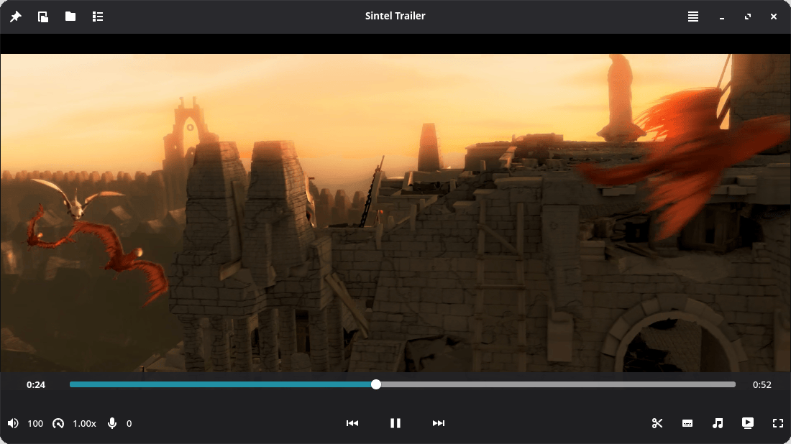
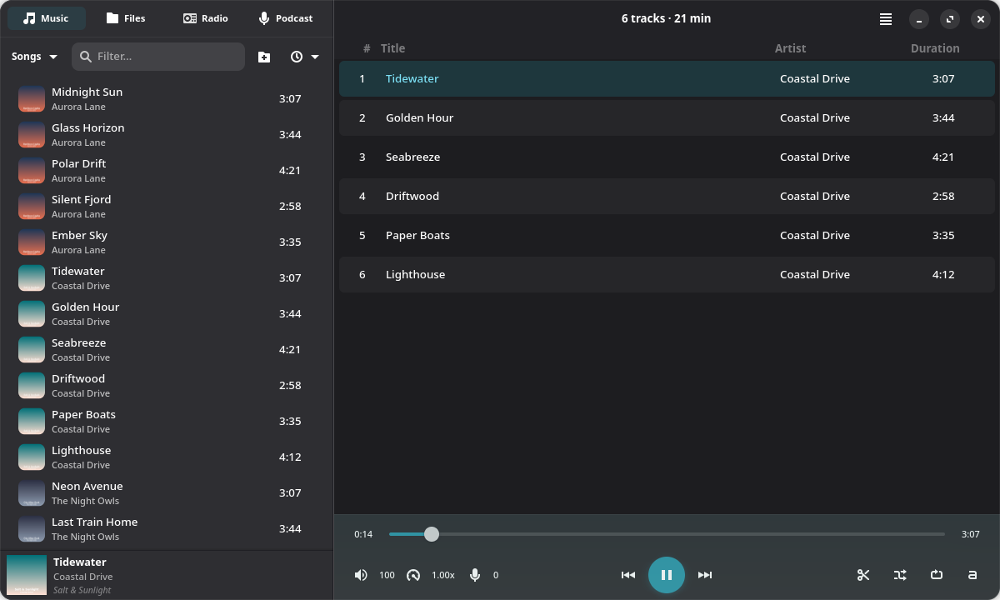

# Big Multimedia

The video and music players of [BigLinux](https://www.biglinux.com.br), built
with GTK 4, libadwaita and mpv.

[](https://github.com/biglinux/big-multimedia/actions/workflows/build-package.yml)
[](LICENSE)



## Players

| Player | Package | What it is for |
|---|---|---|
| [Big Video Player](crates/big-video-player/README.md) | `big-video-player` | Movies, series, streams and TV channels, with hardware decoding |
| [Big Audio Player](crates/big-audio-player/README.md) | `big-audio-player` | A music library, playlists, internet radio and podcasts |



Both players share one playback engine and one set of interface components,
so they look, sound and behave alike. Each player's README lists its features
and command-line options.

## Install

On BigLinux the players come from the official repositories:

```sh
sudo pacman -S big-video-player big-audio-player
```

Each player has its own recipe:
[`big-audio-player/PKGBUILD`](big-audio-player/PKGBUILD) and
[`big-video-player/PKGBUILD`](big-video-player/PKGBUILD). Build tools that
understand one package per directory, such as `gitrepo`, list both and build
the ones you choose. Inside a checkout, either recipe builds the working tree:

```sh
cd big-video-player && makepkg -si
```

## Build from source

You need the Rust toolchain pinned in
[`rust-toolchain.toml`](rust-toolchain.toml), GTK 4.22 or newer, libadwaita
1.9 or newer, and the libmpv, SQLite, gettext and pkgconf development files.

```sh
cargo build --workspace --locked
cargo run --locked -p big-video-player -- ~/Videos/movie.mkv
cargo run --locked -p big-audio-player
```

[CONTRIBUTING.md](CONTRIBUTING.md) lists the checks a change must pass and how
to run the widget tests without a window reaching your desktop.

## Workspace

| Directory | What it holds |
|---|---|
| [`crates/big-video-player`](crates/big-video-player/README.md), [`crates/big-audio-player`](crates/big-audio-player/README.md) | The two programs |
| [`crates/media-runtime`](crates/media-runtime/README.md) | `big-media-runtime`: mpv playback, casting, probing, settings and the shared translation catalog |
| `crates/foundation` | GTK-free building blocks: OS contracts, the music library data, audio effects, render policy |
| `crates/app` | Application plumbing: actions, MPRIS, dialogs, shortcuts |
| `crates/ui` | Relm4 and libadwaita components, media chrome and the panels both players show |
| `big-video-player/`, `big-audio-player/` | The package recipes |
| `third_party/relm4` | Relm4 with a lifetime patch |

[Workspace architecture](docs/architecture.md) explains how the crates depend
on each other, how the players hand media to the converters and how to
refresh the translation template.

## Documentation

- [docs/](docs/README.md): the index of the guides below.
- [Settings and environment](docs/settings.md): `settings.conf`, every key and
  the environment variables.
- [Persistence and recovery](docs/persistence-and-recovery.md): how saves,
  credentials, the LAN remote and library scans behave when something fails.
- [Native library limits](docs/native-library-limits.md): GTK and libadwaita
  defects behind the `clippy.toml` bans.
- [CONTRIBUTING.md](CONTRIBUTING.md): build, checks and the resource-lifetime
  rules every widget must follow.

Issues and pull requests are welcome on
[GitHub](https://github.com/biglinux/big-multimedia/issues).

## License

The component crates are MIT. The repository as a whole is distributed under
the [GNU General Public License v3.0 or later](LICENSE), because the players
link the GPL playback engine.

## Credits

Built by the [BigLinux](https://www.biglinux.com.br) community, on the
shoulders of [mpv](https://mpv.io), [GTK](https://gtk.org),
[libadwaita](https://gnome.pages.gitlab.gnome.org/libadwaita/) and
[Relm4](https://relm4.org).

The video screenshot shows the trailer of
[*Sintel*](https://durian.blender.org), © Blender Foundation, licensed under
[CC BY 3.0](https://creativecommons.org/licenses/by/3.0/). The music in the
audio screenshot is a generated demo library.
