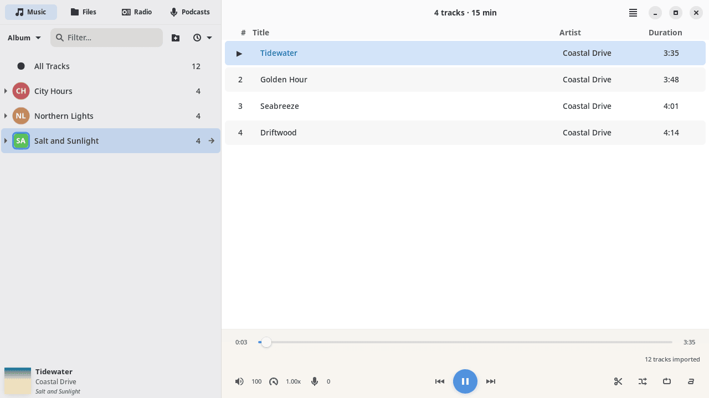

# Big Audio Player

Music and audio player for BigLinux: a music library, playlists, internet
radio, podcasts and lyrics.



It plays through libmpv and takes media keys through MPRIS. A member of the
big-multimedia workspace; see the root [README](../../README.md).

The player converts nothing itself. Trim & Export and Convert hand the track
(and any marked cuts) to `big-audio-converter-gui` through
`big_media_runtime::shared::converter_handoff`.

## Install

On BigLinux the player comes from the official repositories:

```sh
sudo pacman -S big-audio-player
```

To build the package from a checkout, run `makepkg -si` in
[`big-audio-player/`](../../big-audio-player/PKGBUILD) at the repository root.

## Use

Add your music folder with the folder button above the library. The player
scans it in the background, and Ctrl+O opens the list of music folders, where
Scan Now looks for new files. Double-click a track or an album in the library
to play it; the dropdown above the list groups the library by album, artist,
genre or year.

| Key | Action |
|---|---|
| Space | Play or pause |
| Ctrl+Left, Ctrl+Right | Previous or next track |
| Ctrl+F | Search |
| Ctrl+E | Open the equalizer |

Keyboard Shortcuts, in the main menu, lists every shortcut and changes it.

## Features

- **Library** of the music folders you choose, scanned in the background and
  searchable as you type, grouped by song, album, artist or genre.
- **Formats**: MP3, FLAC, OGG Vorbis, Opus, AAC, WAV and more.
- **Playlists and queue**, with undo, import of M3U/PLS playlists and smart
  playlists.
- **Internet radio** with recording, and **podcasts** with subscriptions.
- **Lyrics**, a tag editor and album art.
- **Listening**: gapless playback, ReplayGain, an equalizer, playback speed
  that keeps voices at their natural pitch, and a sleep timer.
- **Desktop integration**: MPRIS for media keys and the desktop's player
  controls, and playback on a TV.

## Command line

```sh
big-audio-player [FILE...]
big-audio-player --play-pause | --next | --previous
```

- Local audio files join the queue, skipping those already in it, and the
  first one plays. A playlist file (`.m3u`, `.m3u8`, `.pls`) adds its entries
  instead. URLs are ignored.
- A second launch hands its files to the window already open, or raises it,
  and exits.
- `--play-pause`, `--next` and `--previous` act on the running player and exit
  at once. The desktop file's actions run them from the dock icon's menu. With no player
  running, the option starts the player as a plain launch would, without
  playing anything.

`--help` lists the options; `--help-gapplication` adds GLib's
`--gapplication-service`, which only D-Bus activation uses.

| Exit status | Meaning |
|---|---|
| 0 | The player ran and closed, or handed its files or control to the running player |
| 1 | GLib refused the command line, such as an unknown option, and printed why |

## Layout

- `src/main.rs` calls `run()` in `src/lib.rs`; `lib.rs` also exposes
  `open_in_application` and `open_paths` for multicall hosts
  (big-host, big-modules).
- `src/audio/app.rs`: the `adw::Application` subclass (actions, accelerators,
  file-open broker).
- `src/audio/ui/audio_shell/`: the root Relm4 component that owns the mpv
  backend and routes every panel intent.
- `src/audio/ui/`: library, playlist, queue and dialog components.
- `src/audio/`: display-free engines (library query/scan, lyrics fetch,
  playlist import, queue undo, MPRIS state).
- `application-assets/resources/`: GResource CSS.
- `resources/`: desktop file, AppStream metadata and icon.

## Build and run

```sh
cargo run --locked -p big-audio-player
```

## License

GPL-3.0-or-later (see the repository `LICENSE`).
