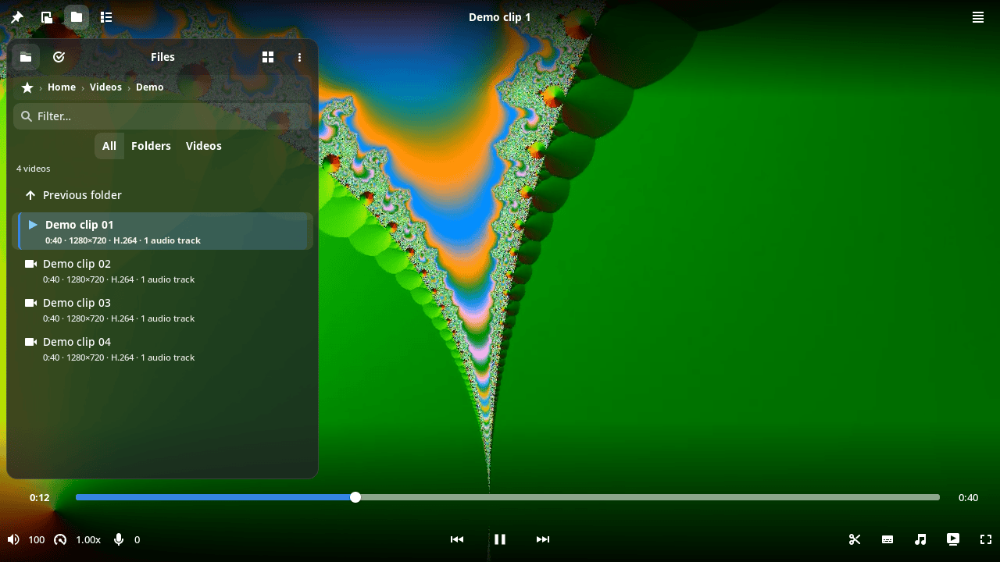

# Big Video Player

Hardware-accelerated video player for BigLinux: local files and folders, IPTV
and online video, with subtitles.



It is built on libmpv with a GL render path, and plays on a TV through the
BigNetScreen daemon. A member of the big-multimedia workspace; see the root
[README](../../README.md).

The player converts nothing itself. Cut Video, Convert and Extract Audio hand
the file (and any marked cuts) to `big-video-converter-gui` or
`big-audio-converter-gui` through
`big_media_runtime::converter_handoff`.

## Install

On BigLinux the player comes from the official repositories:

```sh
sudo pacman -S big-video-player
```

To build the package from a checkout, run `makepkg -si` in
[`big-video-player/`](../../big-video-player/PKGBUILD) at the repository root.

## Use

Open a video from the file manager, or start the player with one:

```sh
big-video-player ~/Videos/movie.mkv
```

The video's folder fills the Files panel, which the folder button at the top
left or F9 opens, and playback continues through that folder. Move the
pointer over the video to show the controls.

| Key | Action |
|---|---|
| Space | Play or pause |
| Left, Right | Seek 5 seconds |
| F | Toggle fullscreen |
| Ctrl+O | Open a file |
| Ctrl+U | Open a URL |

Shortcuts, in the main menu, lists every shortcut and changes it.

## Features

- **Hardware decoding** through VAAPI, VDPAU and NVDEC, on a GL render path
  with a software fallback.
- **Every common format**: MP4, MKV, WebM, MOV, AVI and anything else mpv
  plays, plus DVD and Blu-ray discs, ISO images and folders.
- **Subtitles** with a secondary track, delay control, styling, and loading of
  external files.
- **Picture and sound**: brightness, contrast and color, zoom, crop and
  rotation, HDR tone mapping, an equalizer, and upscaling shaders (FSR, CAS,
  RAVU and Anime4K).
- **Streams and TV**: online video, IPTV playlists and Xtream providers, and
  playback on a TV on the same network.
- **Library at hand**: a folder browser and a play queue in a side panel,
  thumbnail previews on the seek bar, and chapters.
- **Cut and convert**: mark the parts to keep and hand them to Big Video
  Converter, or extract the audio track.
- **Desktop integration**: MPRIS for media keys and the desktop's player
  controls, a sleep timer, screenshots, and configurable keyboard shortcuts.

## Command line

```sh
big-video-player [--new-window] [--maximized] [FILE|URI...]
```

- One local file plays and puts its folder in the sidebar; playback continues
  through that folder in the sidebar's sort order.
- One playlist file (`.m3u`, `.m3u8`, `.pls`) plays its entries.
- One URL plays the stream. The schemes are `http`, `https`, `rtsp`, `rtsps`,
  `rtmp`, `rtmps`, `udp`, `rtp`, `srt`, `mms`, `dvd` and `bd`.
- Several arguments play the media files among them, in the order given.
- Without `--new-window`, a second launch hands its files to the window already
  open, or raises it, and exits. `--new-window` starts a separate player instead.
- `--maximized` opens the window maximized. A launch handed to the running
  player leaves that window's size as it is.

`--help` lists the options; `--help-gapplication` adds GLib's
`--gapplication-service`, which only D-Bus activation uses.

| Exit status | Meaning |
|---|---|
| 0 | The player ran and closed, or handed its files to the running player |
| 1 | GLib refused the command line, such as an unknown option, and printed why |

## Layout

- `src/main.rs` calls `run()` in `src/lib.rs`; `lib.rs` also exposes
  `open_in_application` and `open_paths` for multicall hosts (big-host,
  big-modules).
- `src/video/app.rs`: the `adw::Application` subclass (actions, accelerators,
  file-open broker).
- `src/video/ui/video_shell/`: the root Relm4 component that owns the mpv
  backend, the render surface, MPRIS and the cut marks (`trim/`).
- `src/video/ui/`: controls bar, browser sidebar, preferences, appearance,
  filters, IPTV and cast components.
- `application-assets/resources/`: GResource CSS.
- `resources/`: desktop file, AppStream metadata and icon.

## Build and run

```sh
cargo run --locked -p big-video-player
```

## License

GPL-3.0-or-later (see the repository `LICENSE`).
